+++
date = '2026-11-01T21:59:14+03:00'
draft = false
title = 'Crackme Wheredakey'
+++

# Разбор простого задания с сайта crackmes.one "Wheredakey" от Glitch_Baby

В этой статье разберём основные способы решения crackme и используемые инструменты на примере простого задания.

Ссылка на задание: https://crackmes.one/crackme/6ab4ce5195b976f8f1300b54

При решении использовались следующие инструменты:
- Cutter - универсальный инструмент, в нём есть достаточный для базовых задач дизасемблер, декомпилятор, просмотрщик строк, dachboard и др.;
- pwndbg - это удобный плагин для gdb, одного из лучших отладчиков;

## Этап первый: разведка и сбор информации
Для начала глянем, что наш файл вообще из себя представляет, откроем его в Cutter и посмотрим на dashboard:

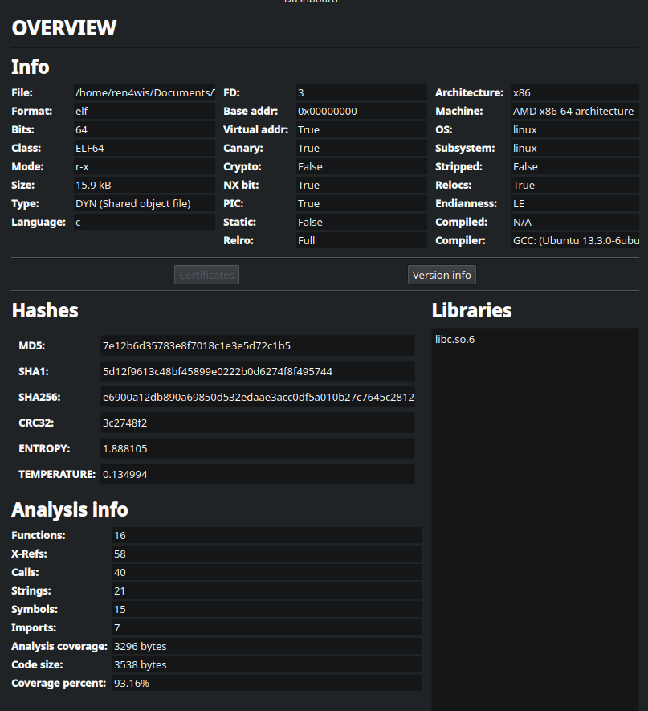

Видим, что это elf файл, для архитектуры x86-64, написанный предположительно на Си. Можем посмотреть его хэши, энтропию и тд. 

Посмотрим строки в соответствующей вкладке Cutter:

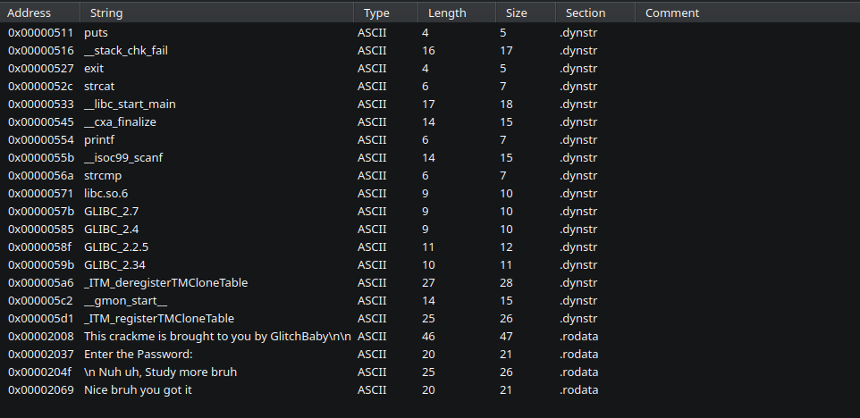

Видим некоторую служебную информацию и внизу 4 вполне осмысленные строки: название задания, просьбу ввести пароль и два возможных ответа - угадали мы или нет, значит можно уже предположить, что при запуске эта программа представится, попросит нас ввести пароль и если он совпадёт поздравит, а если нет, то предложит учиться больше. Проверим гипотезу, запустив бинарь в терминале: 

Не запускайте неизвестные файлы на своём хосте! Используйте виртуальные машины или, как минимум, проверяйте файл антивирусом или VirusTotal


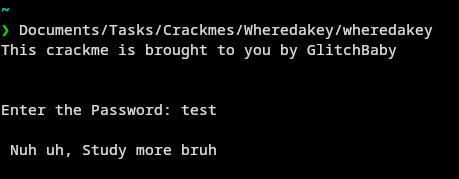

Получили то, что ожидали. Начинаем копать глубже.

## Статический анализ (решение №1)
Закидываем бинарник в Cutter. Он, кстати, сам радостно определил функцию main (что бывает далеко не всегда). В ней и крутится вся основная логика программы. Остальные функции — это служебный мусор и стандартные сишные библиотеки, на них время не тратим. Прыгаем сразу в Graph view:

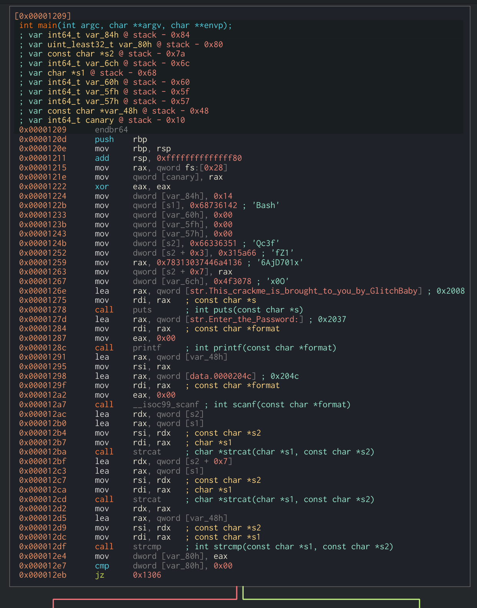
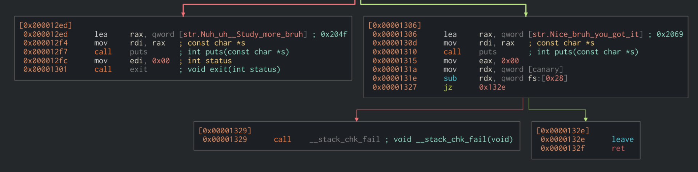

Глаза сразу цепляются за развилку в самом низу графа. Справа видим сообщение об успехе ("Nice bruh..."), слева — ругань на неправильный пароль ("Nuh uh..."). От правой ветки идёт ещё одно ветвление, но оно нас уже не интересует. Давайте посмотрим, кто рулит этим главным переходом.
Видим инструкцию jz (jump if zero) — прыжок к правильному ответу сработает, если предыдущее сравнение выдало ноль. А выше мы как раз сравниваем с нулём переменную var_80h, куда только что залетел результат из регистра eax. Откуда дровишки в eax? Поднимаем взгляд еще на строчку выше и видим вызов strcmp. Ага, значит мы сравниваем какие-то две строки обычной сишной функцией, а результат летит в eax.
Давайте размотаем, что именно мы тут сравниваем. В 64-битном Linux первый аргумент функции всегда кладется в регистр rdi. Там у нас болтается переменная var_48h. Если глянуть чуть выше, она же скармливалась функции scanf — бинго, это наш пользовательский ввод! Мысленно (или прямо в Cutter) переименовываем её в input, чтоб проще читалось.

А с чем сравнивается наш ввод? Второй аргумент strcmp лежит в rsi. Там живет переменная s1, которая как-то хитро собирается. Видим аж два вызова функции strcat, которая склеивает строки. Значит, правильный пароль собирается по кусочкам прямо перед проверкой.
Смотрим внимательно на первый strcat: 
- Первым аргументом (куда клеим) летит значение переменной s1. Выше она объявлена как 0x68736142. Дизассемблер любезно подсказывает, что если перевести это в ASCII с учётом Little-Endian, получится строка Bash.
- Вторым аргументом (что клеим) летит кусок переменной s2 (там же рядом видно объявление Qc3f, а чуть ниже к нему дописывается кусок fZ1, байты f накладываются друг на друга - см. ниже про overlap - и получается в итоге Qc3fZ1).
Результат склейки BashQc3fZ1 сохраняется обратно в s1.

А вот дальше начинается главная засада этого крякмиса — второй вызов strcat.
Смотрим на аргументы: первым всё так же летит наша собираемая строка s1 (там уже лежит BashQc3fZ1), а вот вторым летит не просто переменная, а адрес со смещением: s2 + 7. Программа говорит: «Встань на начало s2, шагни на 7 байт вперед и приклей всё, что там найдешь, пока не уткнешься в нулевой байт `0x00`».

Смотрим в дизассемблер, что же лежит по этому адресу. А там через инструкцию mov записывается здоровенное 8-байтовое значение 0x78313037446a4136 (в тексте это 6AjD701x). Но тут есть нюанс: нулевого байта в конце этой строки нет! Значит, strcat пойдет читать память дальше.

А что лежит дальше? Прямо следующей инструкцией программа кладет 4 байта 0x4f3078 (это x0O плюс тот самый спасительный нулевой байт в конце, т.к переменная dword 4 байта, у нас записано три, остаток заполняется нулём). Казалось бы, пароль должен быть BashQc3fZ1 + 6AjD701x + x0O. Но если ввести это, получим ошибку. Почему?

Тут нужно внимательно посмотреть на адреса переменных в памяти. Происходит классическое перекрытие памяти (memory overlap). Восьмибайтовая переменная ложится на стек так, что её последний байт (буква x) попадает ровно в ту же ячейку, с которой начинается следующая переменная var_6ch.

В итоге программа пишет x, а следующей же командой затирает его первым байтом второй строки (там тоже буква x). Процессор не сдвигает данные, он просто перезаписывает их поверх.

Поэтому лишняя буква "съедается", и финальный кусок выглядит как 6AjD701x0O. Склеиваем всё вместе и получаем наш заветный флаг: BashQc3fZ16AjD701x0O.

## Динамический анализ (решение №2)
Если считать смещения байтов на стеке лень (а иногда там бывает та еще каша), можно использовать отладчик. Идея простая: программа всё равно должна сама собрать правильный пароль в памяти, чтобы сравнить его с нашим вводом. Так давайте просто подсмотрим результат!

Расчехляем GDB (очень рекомендую накатить плагин pwndbg, он делает вывод красивым и понятным).

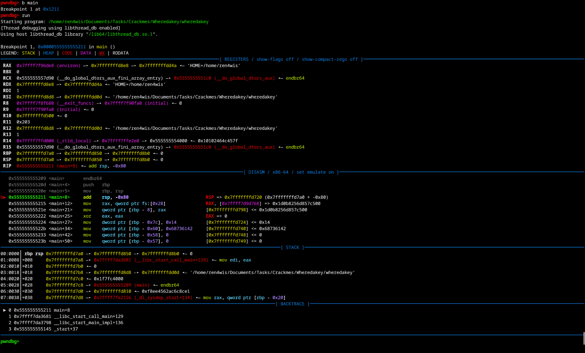

Выведем дизассемблер для main:

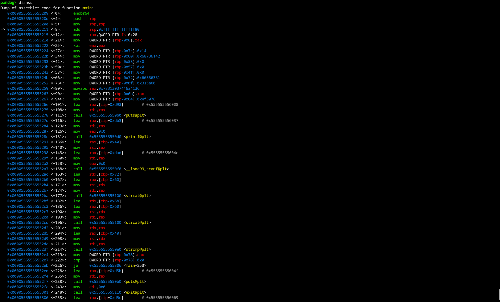

Сначала хочется просто взять адрес инструкции call strcmp из дизассемблера и поставить брейкпоинт, но тут нас ждет облом. Бинарник скомпилирован с защитой PIE (Position Independent Executable), поэтому при каждом запуске операционка закидывает его по новым случайным адресам.

Не беда, используем смещения. Находим в дизассемблере, насколько байт вызов strcmp отстоит от начала функции main (у нас это было +214). Ставим точку останова:

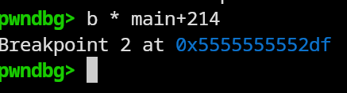

Запускаем программу командой r, вводим любой мусор (например, test) и жмем Enter. Программа послушно собирает правильный пароль, доходит до сравнения и замирает.

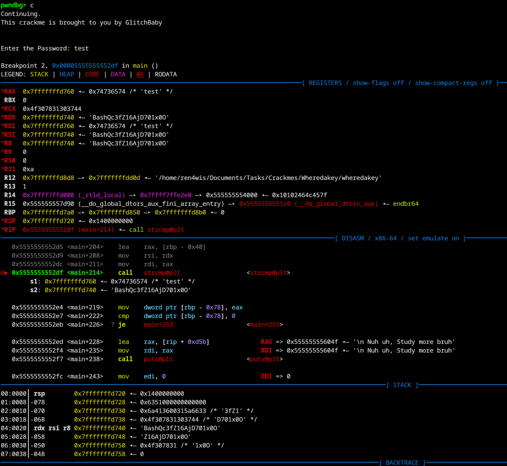

Смотрим в вывод регистров. В 64-битном Linux аргументы в функции передаются через регистры rdi (первый) и rsi (второй).

- В rdi лежит наш ввод (test).
- В rsi красиво и в открытом виде лежит заботливо собранный программой пароль: BashQc3fZ16AjD701x0O
Берем, копируем, таск решен!

### Бонусный способ решить с помощью gdb
Вместо того чтобы искать правильный пароль, мы можем просто заставить программу принять любой неправильный. И для этого даже не обязательно патчить файл на диске — всё можно сделать прямо в оперативной памяти через отладчик, подменив флаг процессора.

*Краткий ликбез: что такое Zero Flag (ZF)?*
Внутри процессора есть специальный регистр флагов (EFLAGS/RFLAGS), где хранятся "статусы" последних математических операций. ZF — это "Флаг Нуля". Когда программа выполняет инструкцию сравнения cmp eax, 0 (а именно она стоит сразу после вызова strcmp), процессор по сути вычитает одно из другого. Если результат равен нулю (то есть значения совпали), процессор радостно поднимает флаг ZF (ставит его в 1).
Следующая инструкция jz (jump if zero) вообще не смотрит на переменные. Она смотрит ТОЛЬКО на этот флаг. Если ZF=1 — прыгаем к успеху.

Как это заабузить:

    Ставим брейкпоинт прямо на инструкцию jz (или на cmp перед ней).

    Вводим абсолютно любой неправильный пароль.

    Программа отрабатывает, понимает, что мы ввели дичь, и оставляет флаг ZF опущенным (ZF=0).

    Программа встает на паузу в GDB. И тут в дело вступаем мы.

    Ручками через отладчик меняем состояние процессора. В GDB это можно сделать командой set $zf = 1 (если используете pwndbg).

    Отпускаем программу выполняться дальше командой c (continue).

Инструкция jz просыпается, смотрит на флаг, видит там единицу (которую мы подкинули) и пускает нас по ветке правильного пароля, выводя: Nice bruh you got it. Мы прошли аутентификацию, не меняя ни байта в самом файле!

## Патчим файл (решение №3)
Если искать или подбирать пароль совсем лень, можно просто переписать правила игры. Заставим бинарник принимать любой неправильный пароль!

Для этого открываем наш файл в Cutter, но обязательно выбираем Write mode (режим записи: file -> set mode -> write mode). В этом режиме мы не просто читаем ассемблер, а меняем оригинальный файл на диске.

Находим ту самую инструкцию jz (jump if zero), которая стоит после проверки strcmp. Кликаем по ней правой кнопкой мыши, выбираем Edit и меняем инструкцию на jnz (jump if not zero).

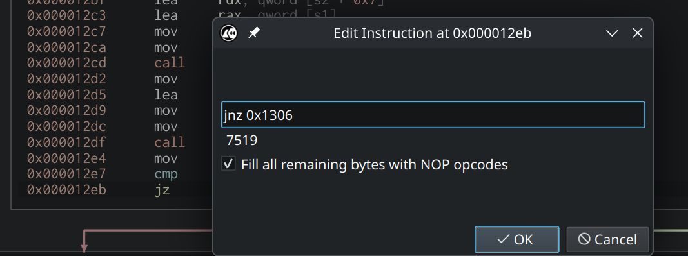

Всё, логика перевернута с ног на голову ! Теперь программа будет писать ошибку на единственный правильный пароль, а любой мусорный ввод будет считать успешным.

Важный нюанс: перед тем как радостно бежать в терминал проверять наш взлом, Cutter нужно закрыть (или переключить обратно в Read-only). Если попытаться запустить измененный файл, пока он открыт в режиме записи, Linux выдаст ошибку text file busy. Операционка просто не даст выполнить код, пока другой процесс (наш Cutter) держит его открытым для редактирования.

Закрываем Cutter, пишем в терминале ./wheredakey, вводим пароль 123 и лутаем победное Nice bruh you got it!

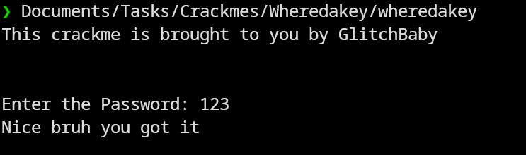