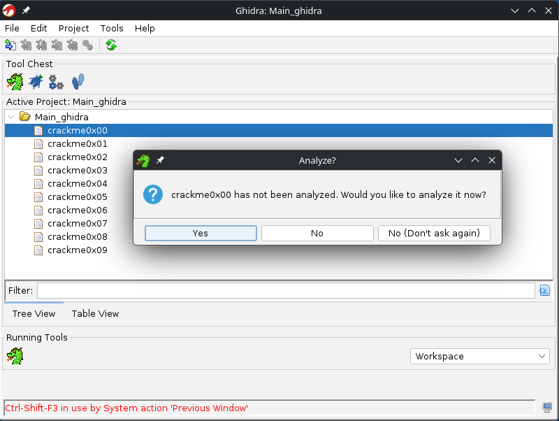
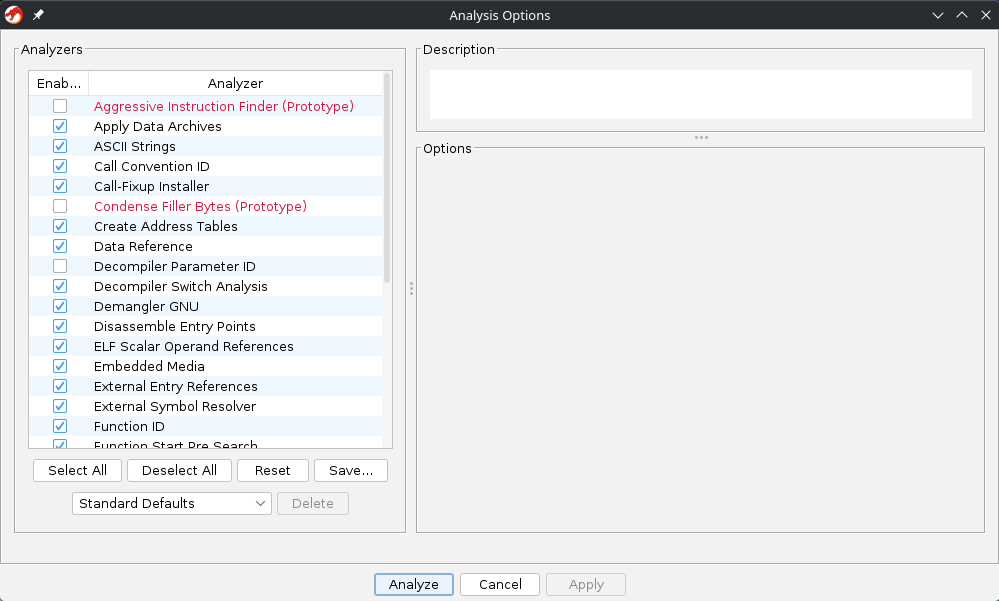
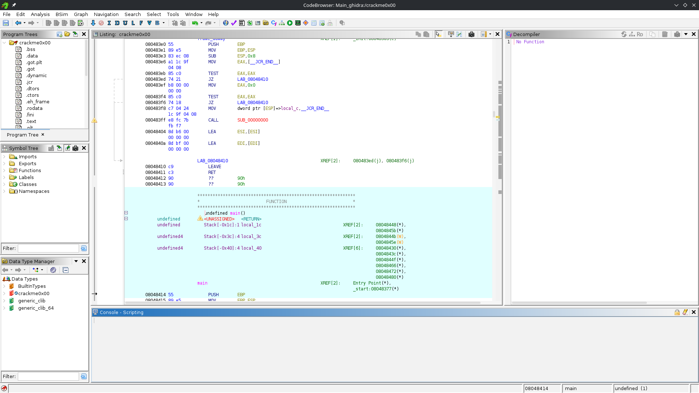
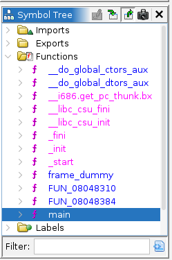
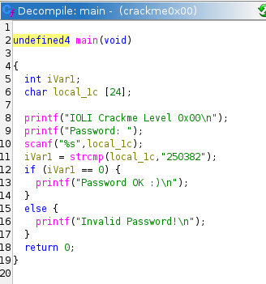
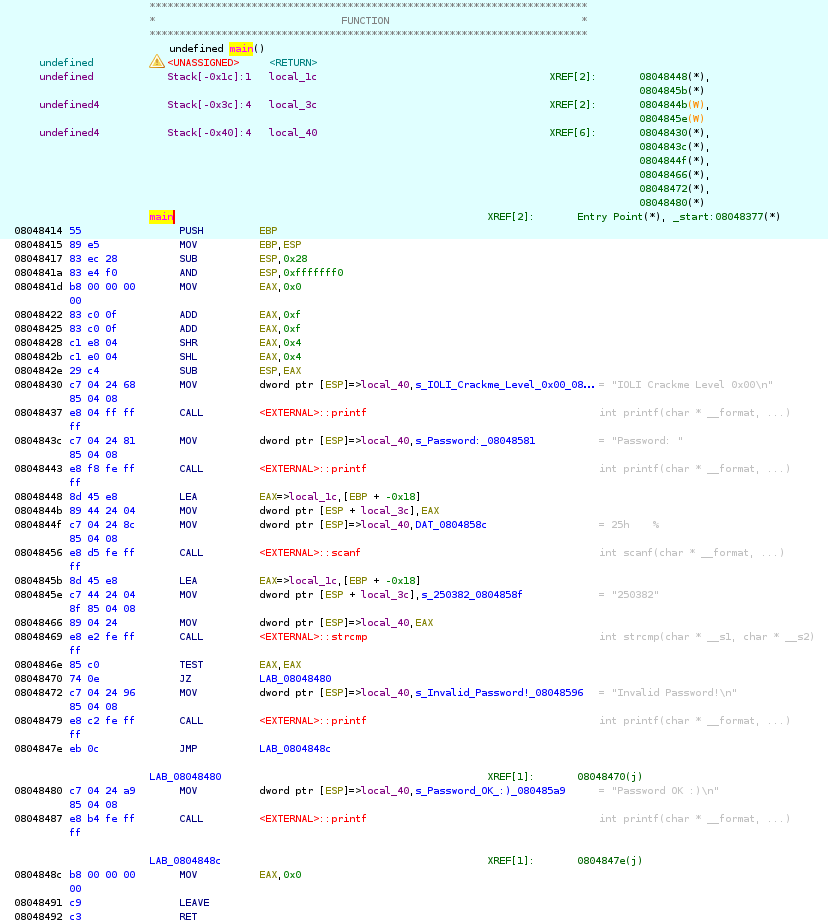
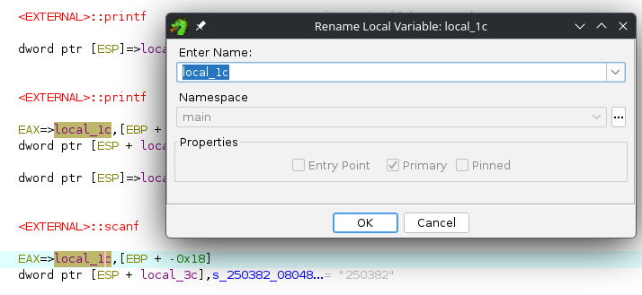

+++
date = '2026-11-02T17:23:10+03:00'
draft = false
title = 'Введение в Ghidra: разбираем интерфейс и решаем IOLI Crackme 0x00'
tags = ["reverse-engineering", "crackme", "ghidra", "x86", "assembly", "ioli"]
series = ["IOLI Crackme"]
series_order = 1
+++

Начинаем серию статей по базовому реверс-инжинирингу. Разбирать будем классические таски IOLI Crackme (с 0x00 по 0x09). В этой первой части познакомимся с Ghidra: поставим её, настроим под себя рабочее место, разберёмся с базовыми окнами, научимся читать ассемблер x86, вспомним calling conventions и решим самый первый таск — Crackme 0x00.


Серия **IOLI crackme** — это отличный тренажер для старта в реверсе. Задачки старые, но на них до сих пор идеально учиться: от банального поиска захардкоженных строк до циклов, арифметики и указателей. Взять их можно здесь [The Official Radare2 Book](https://book.rada.re/crackmes/intro.html).

Начнем с самого простого — таска **0x00** — попутно разбираясь с инструментом.

### Сводка по таску

| Параметр | Значение |
|---|---|
| **Формат / Архитектура** | ELF 32-bit x86 |
| **Использованный софт** | Ghidra |
| **Правильный пароль** | `250382` |

---

## Что такое Ghidra

Если коротко: Ghidra — это бесплатный фреймворк для реверса от АНБ (NSA), который они выложили в открытый доступ еще в 2019 году. 

Раньше стандартом была IDA Pro, но лицензия на неё стоит космических денег (особенно если нужен декомпилятор). В Гидре же декомпилятор встроен сразу из коробки, поддерживает кучу архитектур (x86, x64, ARM, MIPS и даже всякую экзотику) и спокойно работает на Linux, Windows и macOS. Для старта и повседневных задач — вариант отличный. К тому же в большинстве вакансий Ghidra уже является стандартом как альтернатива или дополнение к IDA Pro.

---

## Установка и запуск

Гидре для работы нужна Java (JDK 17 или 21). Без неё она даже не запустится.

### 1. Ставим Java
* **Ubuntu / Debian:**
  ```bash
  sudo apt update && sudo apt install openjdk-21-jdk
  ```
* **Arch Linux:**
  ```bash
  sudo pacman -S jdk-openjdk
  ```
* **Windows:**
  Качаем установщик OpenJDK (например, [Eclipse Temurin](https://adoptium.net/)) и ставим как обычную программу.

### 2. Скачиваем и запускаем Ghidra
Идем на официальный сайт [ghidra-sre.org](https://ghidra-sre.org/) или в релизы на GitHub и качаем ZIP-архив.

Распаковываем архив в любое удобное место. Установки как таковой нет, просто дергаем стартовый скрипт:
* В **Linux / macOS**: `./ghidraRun`
* В **Windows**: `ghidraRun.bat`

---

## Создаем проект и импортируем файлы

При запуске открывается менеджер проектов. В Гидре всё лежит внутри проектов — это такие папки-контейнеры, где хранятся исследуемые файлы и результаты анализа.

### 1. Создаем проект
Жмем **File -> New Project** (или `Ctrl+N`):
1. Выбираем **Non-Shared Project** (локальный проект для себя) и жмем *Next*.
2. Указываем путь к папке и пишем имя проекта (например, `Main_ghidra`). Жмем *Finish*.

### 2. Закидываем бинарники
Импортировать файлы можно по-разному:
* По одному: **File -> Import File** (хоткей `I`).
* Пачкой: **File -> Batch Import** (хоткей `B`).


Если у вас скачан архив со всеми заданиями (`crackme0x00`–`crackme0x09`), используйте **Batch Import**! Выбираете папку с крякмисами, и Гидра сама подтянет их все в проект одним махом.


### 3. Открываем файл и запускаем автоанализ
Дважды кликаем по `crackme0x00`. Гидра видит, что файл новый, и спрашивает, хотим ли мы запустить анализ:



Жмем **Yes**. Открывается окно **Analysis Options**:



Здесь перечислены стандартные анализаторы: поиск строк, разбор функций, вызовов и прочего. Дефолтных чекбоксов хватает за глаза, поэтому просто жмем **Analyze**. В правом нижнем углу пробежит полоса загрузки.

---

## Знакомимся с интерфейсом CodeBrowser

Когда анализ закончится, перед нами откроется главное рабочее окно — **CodeBrowser**.



С непривычки окон тут многовато, поэтому сразу наведем порядок:

1. **Закрываем консоль:** внизу висит окно **Console - Scripting**. Пока мы не пишем скрипты автоматизации, оно просто занимает место на экране. Закрываем его на крестик (если понадобится, всегда можно вернуть через верхнее меню `Window`).
2. **Symbol Tree (слева):** дерево всех символов. Тут лежат импорты, экспорты и функции программы.
3. **Listing (по центру):** окно дизассемблера. Здесь отображаются адреса, машинные байты, ассемблерные инструкции и комментарии.
4. **Decompiler (справа):** декомпилятор, который пытается перевести ассемблер обратно в читаемый Си-код.

### Ищем функцию `main`
Слева в окне **Symbol Tree** разворачиваем папку **Functions**:



Среди стандартных системных функций компилятора находим `main` и кликаем по ней. Листинг по центру сразу прыгнет на адрес `08048414` — точку входа в нашу функцию.

---

## Декомпилятор vs Дизассемблер: зачем нам вообще ассемблер?

Если после перехода на `main` кликнуть по коду в центральном окне листинга, декомпилятор справа оживет и покажет вот такую картину:



```c
undefined4 main(void)
{
  int iVar1;
  char local_1c [24];

  printf("IOLI Crackme Level 0x00\n");
  printf("Password: ");
  scanf("%s",local_1c);
  iVar1 = strcmp(local_1c,"250382");
  if (iVar1 == 0) {
    printf("Password OK :)\n");
  }
  else {
    printf("Invalid Password!\n");
  }
  return 0;
}
```

И тут логичный вопрос: а зачем вообще ковыряться в ассемблере, если декомпилятор буквально выдал весь исходник на блюдечке?
* Выделяется буфер `local_1c` на 24 байта.
* Выводится приветствие и просьба ввести пароль.
* Через `scanf` ввод пишется в `local_1c`.
* Через `strcmp` строка сравнивается с `"250382"`.
* Если вернулся 0 (`iVar1 == 0`), то пароль верный.

В этом задании всё действительно элементарно. Но в реальной жизни (да и в тасках посложнее) декомпилятор часто спотыкается: теряет переменные, путает типы данных, превращает хитрые циклы в кашу или скрывает важные побочные эффекты.

Поэтому запоминаем правило: **декомпилятором пользуемся для быстрой ориентации и обзора структуры, но реальную логику всегда проверяем по ассемблеру.**

---

## Разбираем ассемблерный листинг

Смотрим в центральное окно листинга:



Давайте размотаем, что тут происходит на уровне инструкций.

### 1. Пролог функции и стек
В самом начале функции видим стандартный блок:

```asm
08048414  55              PUSH       EBP
08048415  89 e5           MOV        EBP, ESP
08048417  83 ec 28        SUB        ESP, 0x28
0804841a  83 e4 f0        AND        ESP, 0xfffffff0
```

Это **пролог функции** — шаблон, который компилятор ставит на входе:
* `PUSH EBP` — сохраняем старый базовый указатель на стек.
* `MOV EBP, ESP` — делаем текущую вершину стека (`ESP`) новой базой (`EBP`). Теперь через `EBP` мы будем удобно обращаться к локальным переменным.
* `SUB ESP, 0x28` — стек растет вниз (от больших адресов к меньшим). Вычитая `0x28` (40 байт), мы резервируем 40 байт на стеке под наши локальные переменные.
* `AND ESP, 0xfffffff0` — выравниваем вершину стека по границе 16 байт (зануляем последние биты), чтобы процессору было удобнее работать с памятью.

А в самом конце функции находится **эпилог**:

```asm
0804848c  b8 00 00 00 00  MOV        EAX, 0x0
08048491  c9              LEAVE
08048492  c3              RET
```
* `MOV EAX, 0` — готовим возвращаемое значение (наш `return 0`).
* `LEAVE` — восстанавливает стек (по сути это `MOV ESP, EBP` и `POP EBP`).
* `RET` — забирает со стека адрес возврата и отдает управление обратно вызвавшей функции.

---

### Шпаргалка: Calling Conventions (соглашения о вызовах)

Перед тем как смотреть на вызовы функций, нужно вспомнить, как вообще передаются аргументы в коде. 

**Calling convention** — это правило: в каком порядке передавать аргументы, куда их класть (в регистры или на стек) и кто за собой убирает стек после вызова.

#### 1. 32-битный мир (x86)
В x86 регистров мало, поэтому данные передаются в основном через стек:
* **cdecl:** стандарт для Си под Linux и Windows. Аргументы кладутся на стек **справа налево**. Стек чистит вызывающий код (caller). Результат возвращается в `EAX`.
  *(В GCC под Linux часто вместо `PUSH` аргументы сразу пишут по смещениям от вершины стека: `MOV [ESP], arg1`, `MOV [ESP+4], arg2` — именно это мы сейчас и увидим).*
* **stdcall:** стандарт для Win32 API. Аргументы тоже на стеке справа налево, но стек очищает **сама вызванная функция** перед выходом (`RET n`).
* **fastcall:** первые 2 аргумента передаются в регистрах `ECX` и `EDX`, а остальное через стек.

#### 2. 64-битный мир (x86-64)
Тут регистров много, поэтому на стек данные сбрасывают редко:
* **System V ABI (Linux, macOS):** первые 6 аргументов передаются строго через регистры: `RDI`, `RSI`, `RDX`, `RCX`, `R8`, `R9`. Всё, что не влезло — на стек. Возврат в `RAX`.
* **Microsoft x64 (Windows):** аргументы передаются через 4 регистра: `RCX`, `RDX`, `R8`, `R9`. Плюс вызывающий обязан выделить 32 байта под "теневой стек" (shadow space). Возврат в `RAX`.

| Архитектура / ОС | Соглашение | Где лежат аргументы | Кто чистит стек | Где результат |
|---|---|---|---|---|
| **x86 (Linux / Win)** | `cdecl` | Стек (справа налево) | Вызывающий | `EAX` |
| **x86 (Windows API)** | `stdcall` | Стек (справа налево) | Сама функция | `EAX` |
| **x64 (Linux / macOS)** | `System V` | `RDI`, `RSI`, `RDX`, `RCX`, `R8`, `R9` | Вызывающий | `RAX` |
| **x64 (Windows)** | `MS x64` | `RCX`, `RDX`, `R8`, `R9` (+ 32B shadow space) | Вызывающий | `RAX` |

---

### 2. Вызовы `printf` и `scanf`

Смотрим дальше по листингу:

```asm
08048430  MOV   dword ptr [ESP], s_IOLI_Crackme_Level_0x00...
08048437  CALL  <EXTERNAL>::printf
0804843c  MOV   dword ptr [ESP], s_Password:...
08048443  CALL  <EXTERNAL>::printf
```
Так как у нас 32-битный бинарник и соглашение `cdecl`, первый аргумент должен лежать на вершине стека (`[ESP]`). Программа пишет туда адрес строки и вызывает `printf`. Затем точно так же выводится `Password: `.

Дальше идет считывание ввода:

```asm
08048448  LEA   EAX, [EBP + -0x18]
0804844b  MOV   dword ptr [ESP + 0x4], EAX
0804844f  MOV   dword ptr [ESP], "%s"
08048456  CALL  <EXTERNAL>::scanf
```

Здесь встречаем инструкцию **`LEA` (Load Effective Address)**:
* `LEA EAX, [EBP - 0x18]` — в отличие от `MOV`, она не читает память по этому адресу. Она просто считает формулу `EBP - 0x18` и кладет полученный адрес в `EAX`. Это адрес начала буфера под наш ввод на стеке.
* `MOV [ESP + 4], EAX` — кладем этот адрес вторым аргументом.
* `MOV [ESP], "%s"` — первым аргументом кладем форматную строку.
* Вызываем `scanf("%s", &local_1c)`.

---

### Полезный трюк: переименование переменных и памяти

Имена вроде `local_1c` быстро начинают путаться между собой и вызывать желание закрыть всё это и пойти смотреть на птичек в окно. Чтобы этого избежать и сделать наше дело чуть более приятным, в Гидре всё это можно переименовывать под себя:

Кликаем по переменной и жмем клавишу **`L`** (или ПКМ -> **Edit Lable**):



Пишем понятное имя (например, `user_input`), и оно обновится и в листинге, и в декомпиляторе. Точно так же через `L` можно переименовывать глобальные адреса, строки и функции.

 *PS. Если вам больше нравятся хоткеи IDA, то их можно переназначить, см. например [Ghidra-Keybindings](https://github.com/JeremyBlackthorne/Ghidra-Keybindings).*

---

### 3. Проверка пароля (`strcmp`) и ветвление

Вот главное место проверки:

```asm
0804845b  LEA   EAX, [EBP + -0x18]
0804845e  MOV   dword ptr [ESP + 0x4], "250382"
08048466  MOV   dword ptr [ESP], EAX
08048469  CALL  <EXTERNAL>::strcmp
```

1. В `[ESP]` (первый аргумент) отправляется наш ввод.
2. В `[ESP + 4]` (второй аргумент) отправляется адрес захардкоженной строки `"250382"`.
3. Вызывается `strcmp`.

Функция `strcmp` сравнивает строки и возвращает результат в регистре **`EAX`**: если строки совпали, вернется `0`.

Смотрим на проверку результата:

```asm
0804846e  85 c0   TEST  EAX, EAX
08048470  74 0e   JZ    LAB_08048480
```

* `TEST EAX, EAX` — выполняет побитовое «И». Оно не меняет `EAX`, но если там лежит `0`, процессор выставляет флаг нуля (**Zero Flag, ZF = 1**).
* `JZ LAB_08048480` (**Jump if Zero**) — прыгает по адресу, только если `ZF = 1` (то есть `strcmp` вернула 0, и пароли совпали).

Если мы ввели не то:
```asm
08048472  MOV   dword ptr [ESP], "Invalid Password!\n"
08048479  CALL  <EXTERNAL>::printf
0804847e  JMP   LAB_0804848c
```
Прыжок не срабатывает, выводится `"Invalid Password!\n"`, и безусловный переход `JMP` уводит нас в эпилог к выходу.

А если пароль совпал, мы прыгаем на блок успеха:
```asm
08048480  MOV   dword ptr [ESP], "Password OK :)\n"
08048487  CALL  <EXTERNAL>::printf
```
И получаем поздравление!

---

## Проверяем результат

Запускаем бинарник в терминале и скармливаем ему найденный пароль:

```text
$ ./crackme0x00
IOLI Crackme Level 0x00
Password: test
Invalid Password!

$ ./crackme0x00
IOLI Crackme Level 0x00
Password: 250382
Password OK :)
```

Всё сработало как мы и предполагали.

---

## Что дальше?

В этой вводной части мы:
* Поставили и настроили **Ghidra**.
* Разобрались с окнами **CodeBrowser** (Symbol Tree, Listing, Decompiler).
* Посмотрели, как выглядят пролог и эпилог функции на x86.
* Разобрали соглашения о вызовах (**Calling Conventions**).
* Проследили логику проверки пароля по инструкциям ассемблера.

В следующей статье цикла возьмемся за **Crackme 0x01**, **0x02** и **0x03** — там уже всё будет чуточку сложнее.

 

