+++
date = '2026-11-07T21:40:00+03:00'
draft = false
title = 'Разбор IOLI Crackme 0x01–0x03: граф функций, оптимизации декомпилятора и шифр Цезаря'
tags = ["reverse-engineering", "crackme", "ghidra", "x86", "assembly", "ioli"]
series = ["IOLI Crackme"]
series_order = 2
+++

Во второй части цикла решаем таски IOLI Crackme 0x01, 0x02 и 0x03. Если в прошлый раз мы искали открытую строку, то теперь столкнемся с числами в hex, научимся работать с графом функций (Function Graph), поймаем декомпилятор на скрытых вычислениях, научимся комментировать листинг и разберем первый цикл с шифром Цезаря.


В [прошлой статье]() мы настроили Ghidra, познакомились с базовыми окнами и соглашениями о вызовах на примере элементарного `crackme0x00`. Теперь переходим к следующим уровням. Задания становятся чуть интереснее, и на них удобно разобрать полезные фичи Гидры, которые пригодятся в любом реальном реверсе.

### Сводка по таскам

| Задание | Архитектура | Ключевая концепция | Правильный пароль |
|---|---|---|---|
| **Crackme 0x01** | ELF 32-bit x86 | Ввод чисел (`%d`), инструкция `CMP`, граф функций | `5274` |
| **Crackme 0x02** | ELF 32-bit x86 | Арифметика (`ADD`, `IMUL`), оптимизации декомпилятора, комментарии | `338724` |
| **Crackme 0x03** | ELF 32-bit x86 | Вспомогательные функции, циклы в ассемблере, шифр Цезаря | `338724` |

---

## Crackme 0x01: Числа вместо строк и Function Graph

Открываем `crackme0x01` в Ghidra, соглашаемся на автоанализ и прыгаем в функцию `main`. 

Смотрим в окно декомпилятора:

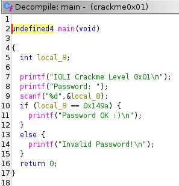

```c
undefined4 main(void)
{
  int local_8;

  printf("IOLI Crackme Level 0x01\n");
  printf("Password: ");
  scanf("%d",&local_8);
  if (local_8 == 0x149a) {
    printf("Password OK :)\n");
  }
  else {
    printf("Invalid Password!\n");
  }
  return 0;
}
```

Логика очень похожа на 0x00, но есть два важных отличия:
1. Вместо строки `%s` функция `scanf` использует спецификатор **`%d`** — программа ждет от пользователя десятичное целое число.
2. Вместо вызова `strcmp` ввод сравнивается напрямую с числом **`0x149a`**.

Префикс `0x` означает шестнадцатеричную систему счисления (hex). Переведем `0x149a` в привычную десятичную систему:
`0x149a = 1 * 16^3 + 4 * 16^2 + 9 * 16^1 + 10 * 16^0 = 4096 + 1024 + 144 + 10 = 5274`

Так как `scanf("%d")` парсит именно десятичные числа, правильный пароль — **`5274`**.

### Смотрим в листинг

Как и договаривались, не ограничиваемся декомпилятором, а смотрим в ассемблер:

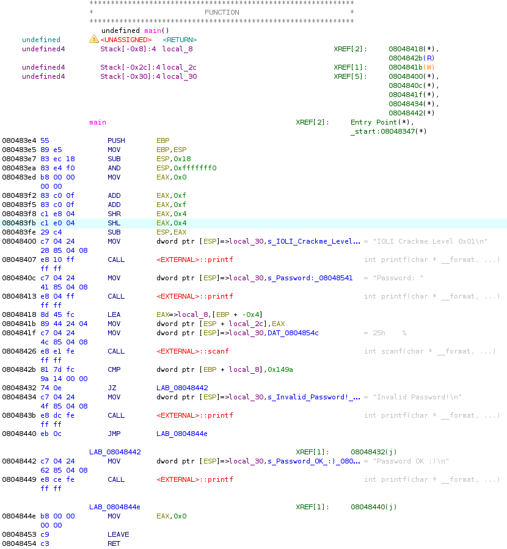

После вызова `scanf` нас интересуют две инструкции:

```asm
0804842b  81 7d fc 9a 14 00 00  CMP  dword ptr [EBP + local_8], 0x149a
08048432  74 0e                 JZ   LAB_08048442
```

* **`CMP` (Compare):** сравнивает значение локальной переменной `local_8` (наш ввод) с константой `0x149a`. Под капотом процессор вычитает одно из другого, никуда не сохраняет результат, но выставляет флаги состояния. Если числа совпали, результат вычитания равен нулю, и процессор поднимает флаг нуля (**Zero Flag, ZF = 1**).
* **`JZ` (Jump if Zero):** условный переход. Если `ZF = 1`, управление передается по адресу `08048442` — в блок вывода поздравления `"Password OK :)"`. Если флаг не поднят, программа идет дальше на печать `"Invalid Password!\n"`.

### Инструмент: Function Graph (Граф функций)

В линейном ассемблерном листинге прыжки через `JZ`, `JNZ` и `JMP` читать не всегда удобно, особенно когда условий и ветвлений становится много. Тут на помощь приходит **Function Graph**.

Открыть его можно кнопкой с иконкой блоков и стрелок на верхней панели инструментов или через меню **Window -> Function Graph**.

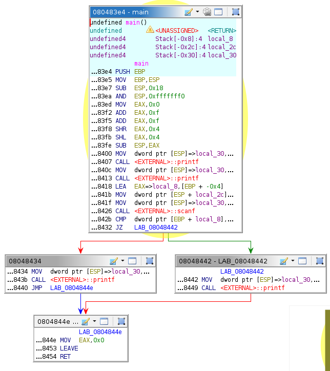

Граф разбивает всю функцию на **базовые блоки** (наборы инструкций, которые гарантированно выполняются последовательно от первой до последней) и наглядно рисует переходы между ними:
* **Зеленая стрелка:** условие перехода выполнено (`ZF = 1`, верный пароль).
* **Красная стрелка:** условие не выполнено (неверный пароль, переход не сработал).
* **Синяя стрелка:** безусловный переход `JMP` (в данном случае выход из ветки неверного пароля в эпилог).

На графе моментально видно классическое ветвление `if-else`: один блок проверки наверху расходится на два блока (`Password OK` и `Invalid Password`), а затем оба сходятся в финальном блоке эпилога функции с `LEAVE` и `RET`.

---

## Crackme 0x02: Фокусы декомпилятора и комментарии в Ghidra

Переходим к `crackme0x02`. Открываем декомпилятор:

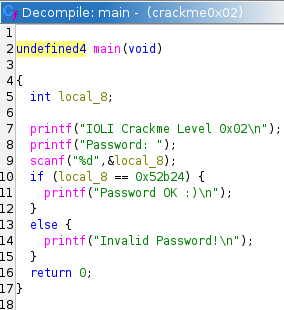

```c
undefined4 main(void)
{
  int local_8;

  printf("IOLI Crackme Level 0x02\n");
  printf("Password: ");
  scanf("%d",&local_8);
  if (local_8 == 0x52b24) {
    printf("Password OK :)\n");
  }
  else {
    printf("Invalid Password!\n");
  }
  return 0;
}
```

Картина один в один как в 0x01: ввели число, сравнили с `0x52b24`. 
Переводим `0x52b24` в десятичный формат:
`0x52b24 = 338724`

Кажется, что задачка снова решилась в один клик. Но если мы откроем листинг ассемблера, нас ждет сюрприз.

### Куда делся кусок кода?

Смотрим в окно дизассемблера между вызовом `scanf` и сравнением:

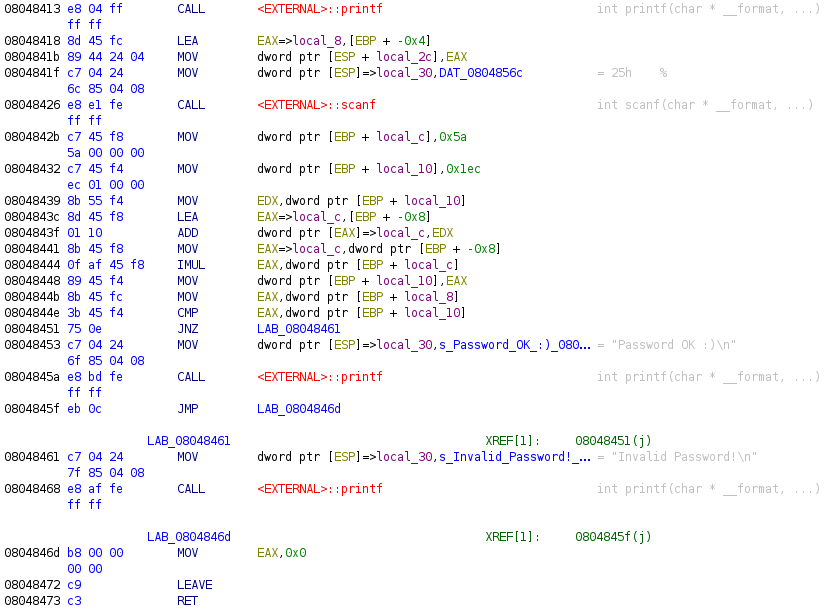

В листинге откуда-то взялась целая пачка инструкций, о которых декомпилятор даже не заикнулся:

```asm
0804842b  c7 45 f8 5a 00 00 00  MOV   dword ptr [EBP + local_c], 0x5a
08048432  c7 45 f4 ec 01 00 00  MOV   dword ptr [EBP + local_10], 0x1ec
08048439  8b 55 f4              MOV   EDX, dword ptr [EBP + local_10]
0804843c  8d 45 f8              LEA   EAX=>local_c, [EBP + -0x8]
0804843f  01 10                 ADD   dword ptr [EAX]=>local_c, EDX
08048441  8b 45 f8              MOV   EAX=>local_c, dword ptr [EBP + -0x8]
08048444  0f af 45 f8           IMUL  EAX, dword ptr [EBP + local_c]
08048448  89 45 f4              MOV   dword ptr [EBP + local_10], EAX
0804844b  8b 45 fc              MOV   EAX, dword ptr [EBP + local_8]
0804844e  3b 45 f4              CMP   EAX, dword ptr [EBP + local_10]
08048451  75 0e                 JNZ   LAB_08048461
```

**Что здесь произошло?**
Перед нами яркий пример **оптимизации констант (Constant Folding)**. Автор программы в исходном коде на Си написал не просто `if (input == 338724)`, а заложил небольшие промежуточные вычисления с переменными:
```c
int a = 0x5a;       // 90
int b = 0x1ec;      // 492
a = a + b;          // 90 + 492 = 582 (0x246)
b = a * a;          // 582 * 582 = 338724 (0x52b24)
if (input == b) ...
```
Поскольку все эти числа известны заранее и не зависят от пользователя, умный декомпилятор Ghidra посчитал всё в уме и выдал нам сразу готовый результат `0x52b24`. 

Для быстрого получения пароля это удобно. Но если бы вместо констант здесь участвовали внешние данные, декомпилятор мог бы запутаться. Поэтому разбираем каждую строчку:

1. `MOV [EBP + local_c], 0x5a` — записывает число `0x5a` (90 в десятичной) в переменную `local_c`.
2. `MOV [EBP + local_10], 0x1ec` — записывает `0x1ec` (492 в десятичной) в `local_10`.
3. `MOV EDX, [EBP + local_10]` — закидывает 492 в регистр `EDX`.
4. `LEA EAX, [EBP - 0x8]` — берет адрес переменной `local_c`.
5. `ADD [EAX], EDX` — прибавляет `EDX` (492) к `local_c` (90). Теперь в `local_c` лежит `582` (или `0x246`).
6. `MOV EAX, [EBP - 0x8]` — помещает 582 в `EAX`.
7. `IMUL EAX, [EBP + local_c]` — инструкция **знакового умножения**: умножает `EAX` сам на себя (`582 * 582`). Получается `338724` (`0x52b24`).
8. `MOV [EBP + local_10], EAX` — сохраняет итоговое число в `local_10`.
9. `MOV EAX, [EBP + local_8]` и `CMP EAX, [EBP + local_10]` — забирает наш ввод и сравнивает его с полученным результатом.
10. `JNZ LAB_08048461` (**Jump if Not Zero**) — если введенное число НЕ совпало (`ZF = 0`), переходит к выводу сообщения об ошибке.

### Фича Ghidra: Комментарии прямо в листинге

Когда логика усложняется, держать в голове все регистры и смещения становится трудно. В Ghidra можно документировать листинг прямо на ходу:

1. Переименуем переменные (хоткей **`L`**): `local_c` назовем `x`, `local_10` — `expected_password`, а `local_8` — `input`.
2. Чтобы оставить комментарий в конце строки, встаем на нужную инструкцию и нажимаем точку с запятой **`;`** (или **ПКМ -> Comments -> EOL**).

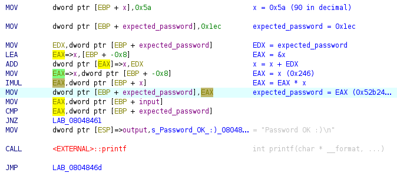

Переведя инструкции в короткий псевдокод прямо в комментариях (`x = x + EDX`, `EAX = EAX * x`), мы получаем идеально читаемый листинг, в котором разберется любой.

---

## Crackme 0x03: Функции, циклы и шифр Цезаря

В третьем крякмисе автор решил не складывать всё в одну функцию `main`, а разбил логику на части.

Открываем вкладку **Functions** в окне **Symbol Tree**:

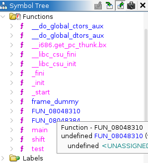

Видим, что помимо `main` здесь появились две интересные функции: **`test`** и **`shift`**.

### Что происходит в `main`

Смотрим декомпилятор и листинг функции `main`:

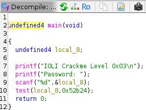
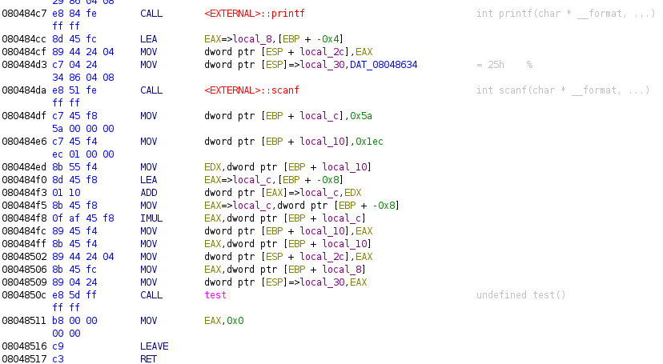

В коде `main` больше нет сравнений пароля и вывода поздравлений:
```c
undefined4 main(void)
{
  undefined4 local_8;

  printf("IOLI Crackme Level 0x03\n");
  printf("Password: ");
  scanf("%d",&local_8);
  test(local_8,0x52b24);
  return 0;
}
```

В ассемблере перед вызовом `test` выполняется ровно та же самая арифметика с константами `0x5a` и `0x1ec`, что и в задании 0x02, давая число `0x52b24` (`338724`). 

Затем оба значения кладутся на стек и передаются в функцию `test`:
```asm
08048502  89 44 24 04  MOV   dword ptr [ESP + 0x4], EAX   ; второй аргумент: 0x52b24
08048506  8b 45 fc     MOV   EAX, dword ptr [EBP + -0x4]  ; первый аргумент: наш ввод
08048509  89 04 24     MOV   dword ptr [ESP], EAX
0804850c  e8 5d ff...  CALL  test
```

То есть правильный ответ для прохождения таска по-прежнему **`338724`**. Но давайте заглянем глубже и посмотрим, как устроены остальные функции.

---

### Функция `test`: передача аргументов

Переходим в функцию `test`:

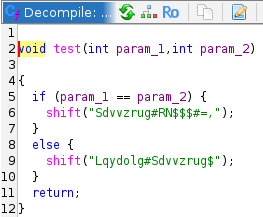
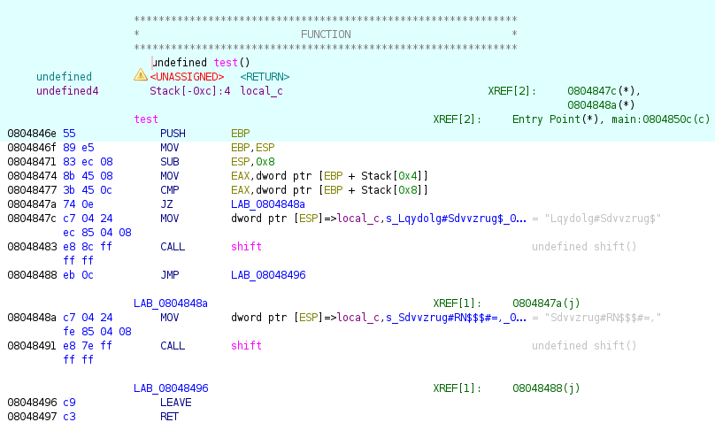

Декомпилятор показывает следующее:
```c
void test(int param_1, int param_2)
{
  if (param_1 == param_2) {
    shift("Sdvvrug#RN$$$#=,");
  }
  else {
    shift("Lqydolg#Sdvvrug$");
  }
  return;
}
```

В листинге хорошо видно, как 32-битная функция забирает переданные ей аргументы со стека через смещения от `EBP`:
```asm
08048474  8b 45 08  MOV  EAX, dword ptr [EBP + 0x8]   ; param_1 (наш ввод)
08048477  3b 45 0c  CMP  EAX, dword ptr [EBP + 0xc]   ; param_2 (0x52b24)
0804847a  74 0e     JZ   LAB_0804848a
```
* `[EBP + 0x8]` — первый аргумент (наш ввод).
* `[EBP + 0xc]` — второй аргумент (`0x52b24`).

Если они равны, программа прыгает на `LAB_0804848a` и вызывает функцию `shift("Sdvvrug#RN$$$#=,")`. Если не равны — вызывает `shift("Lqydolg#Sdvvrug$")`.

Строки выглядят как странный набор символов. Автор зашифровал текст сообщений, а функция `shift` занимается его расшифровкой перед выводом на экран!

---

### Функция `shift`: разбор цикла и шифра Цезаря

Переходим в `shift`. Смотрим на декомпилятор:

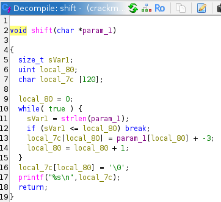

```c
void shift(char *param_1)
{
  size_t sVar1;
  uint local_80;
  char local_7c [120];

  local_80 = 0;
  while( true ) {
    sVar1 = strlen(param_1);
    if (sVar1 <= local_80) break;
    local_7c[local_80] = param_1[local_80] + -3;
    local_80 = local_80 + 1;
  }
  local_7c[local_80] = '\0';
  printf("%s\n",local_7c);
  return;
}
```

Перед нами классический **шифр Цезаря со сдвигом 3**:
* Переменная `local_80` выступает счетчиком цикла `i = 0`.
* Программа берет каждый символ зашифрованной строки `param_1[i]`, вычитает из его кода тройку (`+ -3`) и складывает результат в локальный буфер `local_7c`.
* В конце дописывается нулевой терминатор `\0`, и строка выводится через `printf`.

Давайте проверим вручную на строке `"Sdvvrug#RN$$$#=,"`:
* `'S'` (ASCII 83) - 3 = 80 -> `'P'`
* `'d'` (ASCII 100) - 3 = 97 -> `'a'`
* `'v'` (ASCII 118) - 3 = 115 -> `'s'`
* `'v'` - 3 -> `'s'`
* `'r'` (ASCII 114) - 3 = 111 -> `'w'`
* `'u'` (ASCII 117) - 3 = 114 -> `'o'`
* `'g'` (ASCII 103) - 3 = 100 -> `'r'`
* `'#'` (ASCII 35) - 3 = 32 -> `' '` (пробел)
* `'R'` (ASCII 82) - 3 = 79 -> `'O'`
* `'N'` (ASCII 78) - 3 = 75 -> `'K'`
* `'$'` (ASCII 36) - 3 = 33 -> `'!'` (три раза)
* `'#'` - 3 -> `' '` (пробел)
* `'='` (ASCII 61) - 3 = 58 -> `':'`
* `','` (ASCII 44) - 3 = 41 -> `')'`

Складываем буквы вместе: **`"Password OK!!! :)"`**. 
А строка ошибки `"Lqydolg#Sdvvrug$"` точно так же превращается в `"Invalid Password!"`.

### Как устроен цикл в ассемблере и графе

Теперь посмотрим, как эта конструкция выглядит на низком уровне.

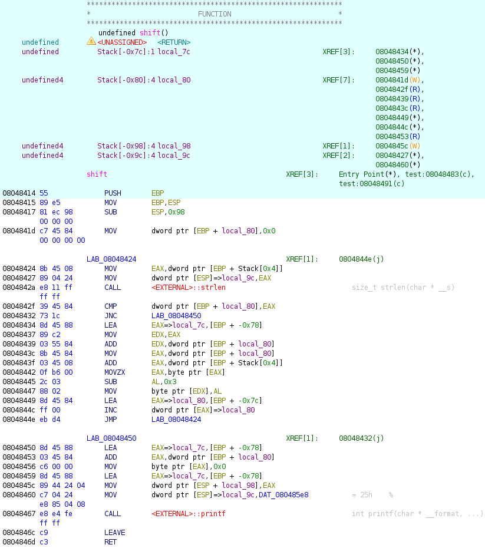
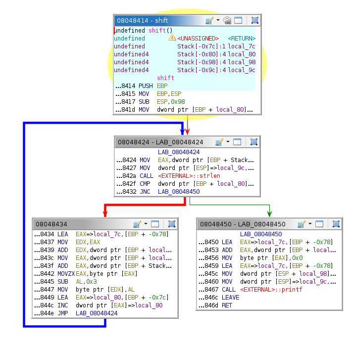

На графе функций циклы видны сразу благодаря обратным стрелкам. Давайте проследим все фазы:

1. **Инициализация:** в верхнем блоке счетчик обнуляется: `MOV [EBP + local_80], 0x0` (`i = 0`).
2. **Заголовок и условие выхода (`LAB_08048424`):**
   - Вызывается `strlen(param_1)` для определения длины строки.
   - `CMP dword ptr [EBP + local_80], EAX` — сравнивает текущий индекс `i` с длиной строки.
   - `JNC LAB_08048450` (**Jump if Not Carry**, он же `JAE` — больше или равно) — если `i >= len`, цикл завершен, и зеленая стрелка уводит нас на блок выхода.
3. **Тело цикла (левый блок):**
   - `MOVZX EAX, byte ptr [EAX]` — загружает очередной зашифрованный символ в регистр `AL`.
   - `SUB AL, 0x3` — то самое вычитание тройки!
   - `MOV byte ptr [EDX], AL` — сохранение расшифрованного байта в результирующий буфер.
   - `INC dword ptr [EAX]=>local_80` — инкремент счетчика (`i++`).
   - `JMP LAB_08048424` — **обратная синяя стрелка**: возвращаемся в начало цикла на проверку длины.
4. **Выход из цикла (правый блок):**
   - `MOV byte ptr [EAX], 0x0` — запись нулевого байта `\0` в конец собранной строки.
   - `CALL printf` — вывод готового сообщения.

---

## Проверка решений

Запускаем все три бинарника в терминале и вводим найденные пароли:

```text
$ ./crackme0x01
IOLI Crackme Level 0x01
Password: 5274
Password OK :)

$ ./crackme0x02
IOLI Crackme Level 0x02
Password: 338724
Password OK :)

$ ./crackme0x03
IOLI Crackme Level 0x03
Password: 338724
Password OK!!! :)
```

Все три таска сдались без боя!

---

## Итог

В этой части мы:
* Научились работать с **Function Graph** и читать ветвления условий.
* Поняли, как декомпилятор за счет **Constant Folding** может упрощать код и скрывать промежуточные расчеты.
* Освоили добавление комментариев и переименование переменных прямо в листинге Ghidra.
* Разобрали, как компилятор организует **циклы** на ассемблере и как работает простейший шифр Цезаря.

Дальше перейдем к более интересным и сложным заданиям из серии IOLI Crackme!
