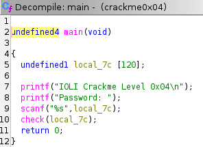
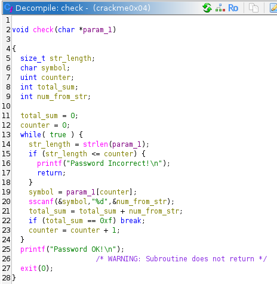
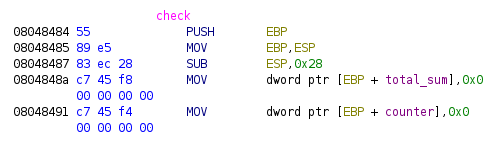
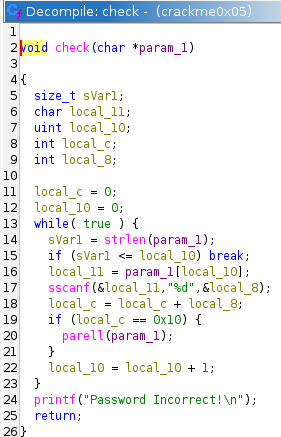
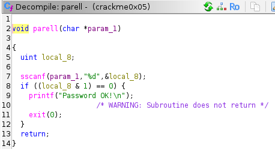
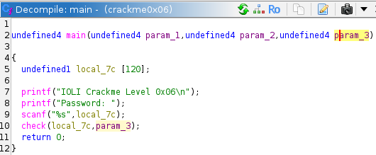
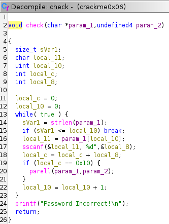
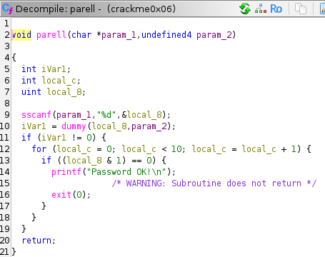
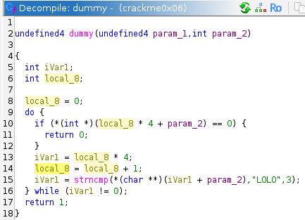
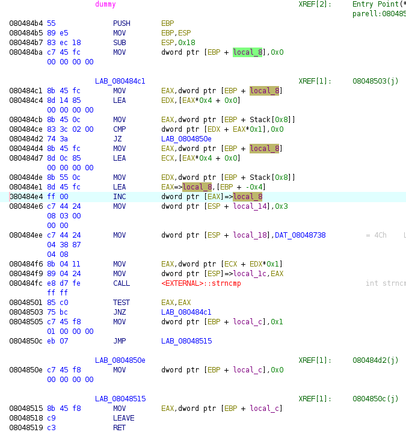

+++
date = '2026-11-15T21:39:28+03:00'
draft = false
title = 'Разбор IOLI Crackme 0x04–0x06: парсинг строк, неинициализированные переменные и envp'
tags = ["reverse-engineering", "crackme", "ghidra", "x86", "assembly", "ioli"]
series = ["IOLI Crackme"]
series_order = 3
+++

В третьей части цикла по IOLI Crackme разбираем следующую тройку заданий: 0x04, 0x05 и 0x06. Здесь автор отходит от простых сравнений захардкоженных констант и начинает проверять свойства паролей: подсчет суммы цифр через `sscanf`, проверку четности побитовым `AND`, ловушки с неинициализированной памятью на стеке, базовую обфускацию и даже чтение переменных окружения (`envp`) из параметров `main`.


В [первой части]() мы разобрались с интерфейсом Ghidra и базовым ассемблером, а во [второй]() научились работать с графом функций и рассмотрели оптимизации декомпилятора. Теперь задачи становятся комплексными: автор заставляет нас глубже вникать в логику Си-функций, работу со стеком и системными вызовами.

### Сводка по таскам

| Задание | Архитектура | Ключевая концепция | Пример правильного решения |
|---|---|---|---|
| **Crackme 0x04** | ELF 32-bit x86 | Посимвольный парсинг `sscanf`, сумма цифр = 15, мусор на стеке | `96` (или `87`, `12345`) |
| **Crackme 0x05** | ELF 32-bit x86 | Сумма цифр = 16, побитовая проверка четности (`n & 1 == 0`) | `88` (или `4444`) |
| **Crackme 0x06** | ELF 32-bit x86 | Аргумент `envp` в `main`, чтение переменных окружения, фейковый цикл | `export LOL=1` и пароль `88` |

---

## Crackme 0x04: Посимвольный парсинг и ловушка на стеке

Открываем `crackme0x04` в Ghidra и традиционно начинаем с функции `main`:



```c
undefined4 main(void)
{
  undefined1 local_7c [120];

  printf("IOLI Crackme Level 0x04\n");
  printf("Password: ");
  scanf("%s",local_7c);
  check(local_7c);
  return 0;
}
```

В `main` ничего нового: выделяется буфер `local_7c` на 120 байт, строка считывается через `scanf("%s")`, после чего передается в функцию `check`. Вся интрига спрятана внутри неё.

### Анализируем функцию `check`

Кликаем дважды по функции `check`. Для наглядности переменные можно сразу переименовать (хоткей **`L`**):



```c
void check(char *param_1)
{
  size_t str_length;
  char symbol;
  uint counter;
  int total_sum;
  int num_from_str;

  total_sum = 0;
  counter = 0;
  while( true ) {
    str_length = strlen(param_1);
    if (str_length <= counter) {
      printf("Password Incorrect!\n");
      return;
    }
    symbol = param_1[counter];
    sscanf(&symbol,"%d",&num_from_str);
    total_sum = total_sum + num_from_str;
    if (total_sum == 0xf) break;
    counter = counter + 1;
  }
  printf("Password OK!\n");
  exit(0);
}
```

Разберем алгоритм цикла:
1. `counter` и `total_sum` инициализируются нулями.
2. В цикле проверяется условие: если `counter` дошел до длины строки `str_length`, значит мы проверили всю строку, но нужную сумму так и не набрали. Выводится `"Password Incorrect!"` и происходит выход.
3. Из строки берется очередной символ: `symbol = param_1[counter]`.
4. Функция `sscanf(&symbol, "%d", &num_from_str)` пытается распарсить символ как десятичное число и записать результат в `num_from_str`.
5. Число прибавляется к накопителю: `total_sum = total_sum + num_from_str`.
6. Проверяется сумма: если `total_sum == 0xf` (15 в десятичной системе), цикл прерывается (`break`), программа выводит заветное `"Password OK!"` и завершается.
7. Иначе счетчик `counter` увеличивается на 1, и цикл повторяется.

На первый взгляд кажется: паролем может быть любая строка, цифры которой в сумме дают 15 (например, `9test6` или `test96`). Но если попробовать ввести их, программа ругнется на неверный пароль. Почему?

### Главная засада: поведение `sscanf` и мусор на стеке

Тут кроется главная ошибка всех, кто начинал учить Си, которая в реверсе превращается в неочевидное условие:

1. **Что делает `sscanf`, если скормить ей букву?**
   Если мы передаем символ `'t'`, функция `sscanf` понимает, что это не число. Она возвращает ошибку, но **НЕ зануляет** переменную `num_from_str`! Она оставляет в ней ровно то значение, которое там лежало до вызова.
   Если мы введем `9test6`:
   - На символе `'9'` в `num_from_str` запишется `9`, а `total_sum` станет `9`.
   - На следующем символе `'t'` функция `sscanf` ничего не запишет, но в `num_from_str` останется прошлая девятка!
   - Программа прибавит её еще раз: `total_sum = 9 + 9 = 18`. Мы моментально перелетели через 15, и пароль забракован.

2. **А почему тогда нельзя поставить буквы в начало (например, `test96`)?**
   Взглянем на дизассемблер самого начала функции `check`:



```asm
08048484  55              PUSH  EBP
08048485  89 e5           MOV   EBP, ESP
08048487  83 ec 28        SUB   ESP, 0x28
0804848a  c7 45 f8 00...  MOV   dword ptr [EBP + total_sum], 0x0
08048491  c7 45 f4 00...  MOV   dword ptr [EBP + counter], 0x0
```

Смотрите внимательно: компилятор обнулил `total_sum` и `counter`, но ячейку под `num_from_str` **никто не инициализировал**! В ней лежит случайный мусор, оставшийся на стеке от предыдущих вызовов. 

Если в начале строки идут буквы, `sscanf` спотыкается на каждой из них, и в `total_sum` несколько раз прибавится этот случайный мусор со стека, гарантированно испортив сумму.

**Итоговый вывод для 0x04:**
Цифры должны идти **строго подряд с самого начала строки**, а их сумма должна дать ровно **15**. Причем всё, что идет после совпадения суммы, программу уже не волнует — цикл сразу выходит на `break`.

Подойдут любые комбинации:
* `96` (9 + 6 = 15)
* `87` (8 + 7 = 15)
* `555` (5 + 5 + 5 = 15)
* `12345` (1 + 2 + 3 + 4 + 5 = 15)

---

## Crackme 0x05: Проверка четности и побитовый AND

В `crackme0x05` функция `main` снова считывает строку и отдает её в `check`. Смотрим декомпилятор:



```c
void check(char *param_1)
{
  size_t sVar1;
  char local_11;
  uint local_10;
  int local_c;
  int local_8;

  local_c = 0;
  local_10 = 0;
  while( true ) {
    sVar1 = strlen(param_1);
    if (sVar1 <= local_10) break;
    local_11 = param_1[local_10];
    sscanf(&local_11,"%d",&local_8);
    local_c = local_c + local_8;
    if (local_c == 0x10) {
      parell(param_1);
    }
    local_10 = local_10 + 1;
  }
  printf("Password Incorrect!\n");
  return;
}
```

Логика почти идентична 0x04:
* `local_10` — это счетчик символов (`counter`).
* `local_c` — сумма цифр (`total_sum`).
* `local_8` — число из символа.
* Отличие первое: теперь сумма проверяется на равенство **`0x10`** (16 в десятичной системе).
* Отличие второе: при совпадении суммы программа не выводит победный текст сразу, а вызывает функцию **`parell(param_1)`**, передавая туда весь наш исходный ввод.

### Что делает функция `parell`

Заглянем внутрь `parell`:



```c
void parell(char *param_1)
{
  uint local_8;

  sscanf(param_1,"%d",&local_8);
  if ((local_8 & 1) == 0) {
    printf("Password OK!\n");
    exit(0);
  }
  return;
}
```

Здесь происходят два действия:
1. `sscanf(param_1, "%d", &local_8)` считывает из строки число целиком (а не по одной цифре, как было в `check`).
2. Проверяется условие: `if ((local_8 & 1) == 0)`.

Вспомним битовое представление чисел:
Младший (нулевой) бит любого целого числа отвечает за его четность. У всех нечетных чисел младший бит равен `1`, а у всех четных — `0`.
Побитовая операция `& 1` (побитовое И) отсекает все биты, кроме младшего:
* `(число & 1) == 0` — число **четное**.
* `(число & 1) == 1` — число **нечетное**.

Если число четное, выводится `"Password OK!"` и вызывается `exit(0)`. Если нечетное — функция просто завершается, управление возвращается в `check`, цикл крутится дальше и в итоге выдает `"Password Incorrect!"`.

**Условия для прохождения 0x05:**
1. Цифры должны идти подряд с начала (помня о проблеме с `sscanf` и мусором на стеке).
2. Сумма цифр должна быть равна **16**.
3. Само число должно быть **четным**.

Подходящие пароли:
* **`88`** (8 + 8 = 16, число 88 четное).
* **`4444`** (4 * 4 = 16, число 4444 четное).
* **`22222222`** (2 * 8 = 16, четное).
* А вот `97` не подойдет: сумма цифр 9 + 7 = 16, но само число 97 нечетное.

---

## Crackme 0x06: Обфускация и переменные окружения (`envp`)

Шестое задание встречает нас необычной функцией `main`:



```c
undefined4 main(undefined4 param_1, undefined4 param_2, undefined4 param_3)
{
  undefined1 local_7c [120];

  printf("IOLI Crackme Level 0x06\n");
  printf("Password: ");
  scanf("%s",local_7c);
  check(local_7c,param_3);
  return 0;
}
```

Обратите внимание на аргументы `main`. Декомпилятор выделил три параметра: `param_1`, `param_2` и `param_3`, причем последний передается в функцию `check`. Что это такое?

### Ликбез: Аргументы функции `main` в Си

Многие привыкли, что у `main` только два аргумента:
```c
int main(int argc, char *argv[])
```
Однако стандарт POSIX и компиляторы GCC поддерживают и третий параметр:
```c
int main(int argc, char *argv[], char *envp[])
```
* `argc` (`param_1`) — количество аргументов командной строки.
* `argv` (`param_2`) — массив строк-аргументов.
* **`envp`** (`param_3`) — массив указателей на строки с **переменными окружения** текущего процесса (`USER=...`, `PATH=...` и т.д.). Массив завершается нулевым указателем `NULL`.

Значит, программа пробрасывает список системных переменных окружения внутрь проверочной функции!

### Цепочка вызовов: `check` -> `parell`

Смотрим в `check`:



Здесь знакомый цикл: сумма цифр должна равняться 16 (`0x10`). При совпадении вызывается `parell(param_1, param_2)` — туда передается введенная строка и наш массив `envp`.

Переходим в `parell`:



```c
void parell(char *param_1, undefined4 param_2)
{
  int iVar1;
  int local_c;
  uint local_8;

  sscanf(param_1,"%d",&local_8);
  iVar1 = dummy(local_8,param_2);
  if (iVar1 != 0) {
    for (local_c = 0; local_c < 10; local_c = local_c + 1) {
      if ((local_8 & 1) == 0) {
        printf("Password OK!\n");
        exit(0);
      }
    }
  }
  return;
}
```

Разбираем логику:
1. `sscanf` читает число из нашего ввода в `local_8`.
2. Вызывается функция `iVar1 = dummy(local_8, param_2)`.
3. Если `dummy` вернула ненулевое значение (`iVar1 != 0`), управление переходит к циклу `for`:
   ```c
   for (local_c = 0; local_c < 10; local_c = local_c + 1) {
     if ((local_8 & 1) == 0) {
       printf("Password OK!\n");
       exit(0);
     }
   }
   ```
   Этот цикл — простейший пример **обфускации (мусорного кода)**. Внутри него просто 10 раз повторяется одна и та же проверка на четность `(local_8 & 1) == 0`. Переменная `local_8` внутри цикла не меняется, поэтому при первой же итерации программа напишет `"Password OK!"` и завершится. Единственная цель этого цикла — запутать аналитика.

Но перед этим нам нужно, чтобы функция `dummy` вернула `1`. Посмотрим, что в ней происходит.

---

### Анализируем функцию `dummy`

Открываем декомпилятор и листинг функции `dummy`:




```c
undefined4 dummy(undefined4 param_1, int param_2)
{
  int iVar1;
  int local_8;

  local_8 = 0;
  do {
    if (*(int *)(local_8 * 4 + param_2) == 0) {
      return 0;
    }
    iVar1 = local_8 * 4;
    local_8 = local_8 + 1;
    iVar1 = strncmp(*(char **)(iVar1 + param_2), "LOLO", 3);
  } while (iVar1 != 0);
  return 1;
}
```

Разматываем код:
1. Первый параметр `param_1` (наше число) вообще не используется в функции.
2. `param_2` — это массив `envp`. В 32-битных системах указатели занимают 4 байта, поэтому `local_8 * 4 + param_2` — это смещение к i-му указателю массива (`envp[i]`).
3. Первая проверка: `if (*(int *)(...) == 0) return 0;`. Массив переменных окружения заканчивается нулем (`NULL`). Если мы дошли до конца и не нашли нужной переменной — функция возвращает `0` (провал).
4. Основная проверка:
   ```c
   strncmp(*(char **)(iVar1 + param_2), "LOLO", 3);
   ```
   Функция `strncmp` сравнивает текущую строку переменной окружения с шаблоном `"LOLO"`, но третий аргумент равен **`3`**! Это значит, что сравниваются только **первые 3 символа**.
5. Если первые три буквы совпали с `"LOL"`, `strncmp` возвращает `0`. Условие цикла `while (iVar1 != 0)` нарушается, цикл прерывается, и функция возвращает **`1`** (успех).

### Собираем все условия для Crackme 0x06

Чтобы программа приняла наш ввод, должны выполниться три правила:
1. В окружении должна существовать переменная, имя которой начинается на **`LOL`** (например, `LOL=1` или `LOLAAA=help`).
2. Сумма цифр введенного пароля должна равняться **16**.
3. Само число должно быть **четным**.

Проверяем решение в терминале:

Экспортируем переменную и запускаем бинарник с паролем `88`:

```bash
$ export LOLAAA=help
$ ./crackme0x06
IOLI Crackme Level 0x06
Password: 88
Password OK!
```


Сработало идеально!

---

## Итог

В этой части мы:
* Разобрались с нюансами работы `sscanf` и выяснили, почему неинициализированный мусор на стеке может ломать логику проверок.
* Изучили побитовую проверку на четность через маску `& 1`.
* Узнали про третий аргумент функции `main` — массив переменных окружения `envp`.
* Познакомились с простыми приёмами обфускации и научились раскручивать проверки внешнего окружения программы.
