+++
date = '2026-11-16T16:42:41+03:00'
draft = false
title = 'Разбор IOLI Crackme 0x07–0x09: стрипнутые бинарники, мёртвый код и __libc_start_main'
tags = ["reverse-engineering", "crackme", "ghidra", "x86", "assembly", "ioli"]
series = ["IOLI Crackme"]
series_order = 4
+++

Финальная, четвертая часть цикла по разбору классической серии IOLI Crackme. В этой статье закрываем последние три задания: 0x07, 0x08 и 0x09. Здесь нас ждут уже вполне взрослые препятствия: стрипнутые бинарники без имен функций, поиск реальной точки входа через `__libc_start_main`, троллинг от автора с мёртвым кодом, скрытые глобальные флаги и позиционно-независимый код с `__i686.get_pc_thunk.bx`.


В [предыдущей части]() мы разбирались с посимвольным парсингом строк, неинициализированной памятью на стеке и проверкой переменных окружения (`envp`). 

В заключительной тройке заданий нас ждут: удаление символьной информации (strip), фальшивые ветки выполнения и относительная адресация.

### Сводка по таскам

| Задание | Архитектура | Ключевая концепция | Правильный пароль |
|---|---|---|---|
| **Crackme 0x07** | ELF 32-bit x86 (stripped) | Поиск `main` через `__libc_start_main`, мертвый код, глобальный флаг | `export LOL=1`, пароль `88` |
| **Crackme 0x08** | ELF 32-bit x86 (not stripped) | Деанонимизация функций от автора (`che()`, глобальная переменная `LOL`) | `export LOL=1`, пароль `88` |
| **Crackme 0x09** | ELF 32-bit x86 (stripped) | PIC-код, трюк с `__i686.get_pc_thunk.bx`, адресация данных через `EBX` | `export LOL=1`, пароль `88` |

---

## Crackme 0x07: Где наш `main`? Разбираемся со Stripped-бинарниками

Закидываем `crackme0x07` в Ghidra, запускаем автоанализ и открываем дерево символов **Symbol Tree**:

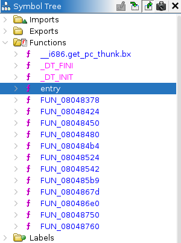

Стоп. А где же привычный `main`?
Вместо понятных имен функций перед нами список безликих `FUN_08048378`, `FUN_080485b9`, `FUN_0804867d`...

Мы впервые сталкиваемся со **стрипнутым бинарником (stripped binary)**.

### Что такое Strip и зачем его делают?

Когда программист компилирует исходный код в исполняемый файл, компилятор по умолчанию сохраняет таблицу символов (`.symtab` и `.strtab`). Там записаны имена всех функций, глобальных переменных и служебная отладочная информация. 

Однако для выполнения программы процессору и операционной системе текстовые имена **не нужны вообще**. Процессор работает исключительно с числовыми адресами в памяти.

Перед релизом софта разработчики обычно выполняют стриппинг (например, утилитой `strip` в Linux или ключом компилятора `-s`). Это:
1. Уменьшает размер бинарника (иногда на десятки процентов).
2. Заметно усложняет жизнь реверсерам, превращая понятные названия функций в безымянную кашу адресов.

Как же в такой каше найти функцию `main`?

---

### Ищем `main` через точку входа (`entry`)

Любой ELF-бинарник в Linux начинает выполнение вовсе не с `main`! 

Первой управление от ядра операционной системы получает точка входа — функция **`entry`** (в исходниках glibc она называется `_start`). Задача этой функции — настроить окружение процесса, выровнять стек и передать параметры в главную функцию инициализации библиотеки libc: **`__libc_start_main`**.

Открываем функцию `entry` в окне дизассемблера:

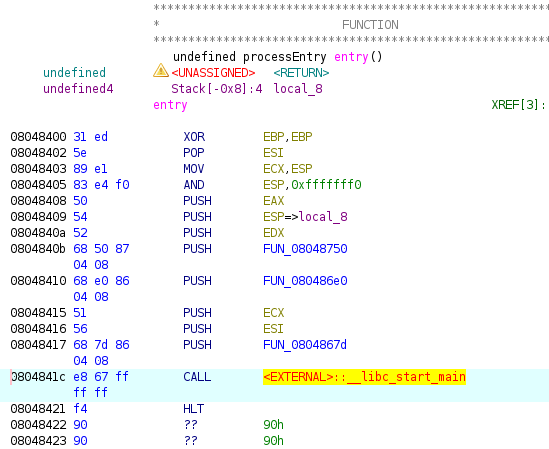

Смотрим на инструкции прямо перед вызовом `CALL <EXTERNAL>::__libc_start_main`:

```asm
08048408  50              PUSH  EAX
08048409  54              PUSH  ESP=>local_8
0804840a  52              PUSH  EDX
0804840b  68 50 87 04 08  PUSH  FUN_08048750   ; указатель на fini
08048410  68 e0 86 04 08  PUSH  FUN_080486e0   ; указатель на init
08048415  51              PUSH  ECX            ; ubp_av
08048416  56              PUSH  ESI            ; argc
08048417  68 7d 86 04 08  PUSH  FUN_0804867d   ; указатель на main!
0804841c  e8 67 ff ff ff  CALL  <EXTERNAL>::__libc_start_main
```

Вспоминаем соглашение о вызовах **cdecl**: аргументы передаются через стек **справа налево**. 


Так как аргументы кладутся справа налево, самый первый аргумент (указатель на `main`) помещается на стек **самым последним**, непосредственно перед инструкцией `CALL`!

И мы четко видим эту инструкцию:
```asm
PUSH  FUN_0804867d
CALL  <EXTERNAL>::__libc_start_main
```

Бинго! Функция с адресом `0804867d`, которую Ghidra назвала `FUN_0804867d`, и есть наш настоящий **`main`**!

---

### Раскручиваем цепочку функций

Переходим в `FUN_0804867d`:

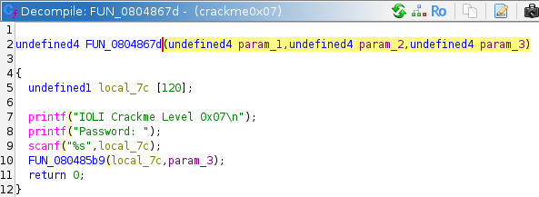

```c
undefined4 FUN_0804867d(undefined4 param_1, undefined4 param_2, undefined4 param_3)
{
  undefined1 local_7c [120];

  printf("IOLI Crackme Level 0x07\n");
  printf("Password: ");
  scanf("%s",local_7c);
  FUN_080485b9(local_7c,param_3);
  return 0;
}
```

Сомнений нет: это наш `main`. 
Нажимаем клавишу **`L`** и переименовываем функцию в `main`.

Дальше смотрим на вызов `FUN_080485b9(local_7c, param_3)`. Это явно наша проверочная функция `check` из прошлого задания. Переименовываем её в `check`.

Открываем `check`:

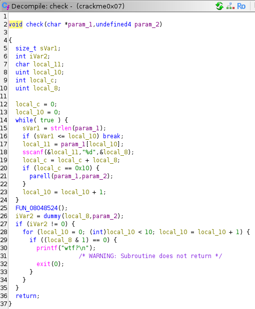

```c
void check(char *param_1, undefined4 param_2)
{
  ...
  while( true ) {
    ...
    if (local_c == 0x10) {
      parell(param_1,param_2);
    }
    local_10 = local_10 + 1;
  }
  FUN_08048524();
  iVar2 = dummy(local_8,param_2);
  if (iVar2 != 0) {
    for (local_10 = 0; (int)local_10 < 10; local_10 = local_10 + 1) {
      if ((local_8 & 1) == 0) {
        printf("wtf?\n");
        exit(0);
      }
    }
  }
  return;
}
```

Внутри цикла всё знакомо: если сумма цифр равна 16 (`0x10`), вызывается функция проверки (переименуем её в `parell`).

А вот дальше в коде `check` начинается самое интересное.

---

### Ловушка: Мёртвый код (Dead Code) и `printf("wtf?\n")`

После завершения цикла суммирования мы видим странный хвост:
1. Вызывается функция `FUN_08048524()`.
2. После неё зачем-то вызывается `dummy(local_8, param_2)`.
3. Крутится цикл на 10 итераций с проверкой на четность и печатью... `"wtf?\n"`!

Что это за `wtf?` и почему мы никогда не видели этой строки при запуске?

Откроем функцию `FUN_08048524`:

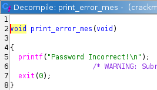

```c
void print_error_mes(void)
{
  printf("Password Incorrect!\n");
  /* WARNING: Subroutine does not return */
  exit(0);
}
```

Все встает на свои места! Функция `FUN_08048524` (назовем ее `print_error_mes`) выводит сообщение об ошибке и вызывает системную функцию **`exit(0)`**.

Функция `exit` **никогда не возвращает управление**. Она немедленно убивает процесс. 

А это значит, что код, расположенный после вызова `print_error_mes()`:
```c
iVar2 = dummy(local_8, param_2);
if (iVar2 != 0) {
  ...
  printf("wtf?\n");
  exit(0);
}
```
— это чистейший **мёртвый код (dead code)**! Автор crackme намеренно вставил недостижимый фрагмент с издевательским `"wtf?"`, чтобы сбить с толку тех, кто бегло смотрит на декомпилятор. До этого участка выполнение не дойдет ни при каких обстоятельствах.

---

### Скрытый глобальный флаг в `dummy` и `parell`

Теперь взглянем на функции `parell` и `dummy`:

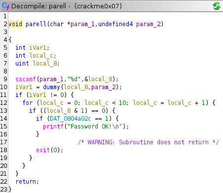
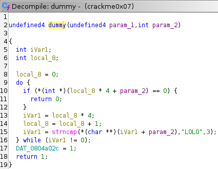

В задании 0x06 функция `dummy` просто возвращала `1`, если находила переменную окружения с `"LOL"`. Но посмотрите на строку 17 в `dummy`:

```c
DAT_0804a02c = 1;
return 1;
```

Перед возвратом `dummy` выставляет глобальную переменную по адресу `0804a02c` в единицу!

А теперь посмотрим в функцию `parell` (строки 13–15):
```c
if ((local_8 & 1) == 0) {
  if (DAT_0804a02c == 1) {
    printf("Password OK!\n");
  }
  exit(0);
}
```

Здесь появилась дополнительная проверка: даже если число чётное, победное `"Password OK!"` напечатается **только в том случае, если глобальный флаг `DAT_0804a02c` равен 1**! Если переменной `LOL` в окружении нет, флаг останется нулем, условие не выполнится, программа молча выйдет через `exit(0)` и мы ничего не получим.

Итоговые условия для 0x07:
1. Переменная окружения, начинающаяся на `LOL` (`export LOL=1`).
2. Четное число с суммой цифр 16 (например, `88` или `4444`).

---

## Crackme 0x08: Деанонимизация от автора

Переходим к следующему файлу — `crackme0x08`. 

И тут нас ждет приятный сюрприз: бинарник **не стрипнут**! В Symbol Tree снова видны все оригинальные имена функций, какими их задумал автор.

Открываем функцию `check`:

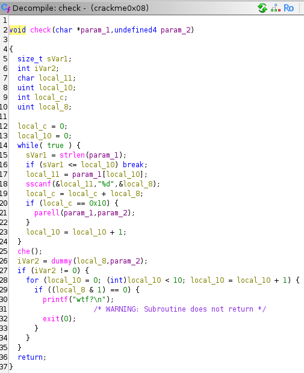

Смотрим на место, где в 0x07 вызывалась безымянная `FUN_08048524`. Теперь на её месте стоит функция с лаконичным названием **`che()`**:

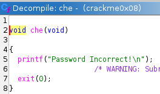

```c
void che(void)
{
  printf("Password Incorrect!\n");
  /* WARNING: Subroutine does not return */
  exit(0);
}
```

Автор просто назвал функцию проверки ошибки `che`. Внутри всё тот же `exit(0)` и тот же самый недостижимый мертвый блок с `"wtf?\n"`.

А что с глобальной переменной `DAT_0804a02c`?
Посмотрим в таблицу символов бинарника (или выполним в терминале `nm crackme0x08`):

```text
0804a02c B LOL
```

Глобальная переменная по адресу `0804a02c` в исходном коде автора буквально называется **`LOL`**! 
В стрипнутом 0x07 Ghidra показала её как безымянный адрес `DAT_0804a02c`, а здесь мы видим её настоящее имя.

Решение полностью совпадает с 0x07: экспортируем `LOL=1` и вводим `88`.

---

## Crackme 0x09: PIC-код, трюк с PC-Thunk и смещения

В финальном задании `crackme0x09` бинарник снова оказывается стрипнутым:

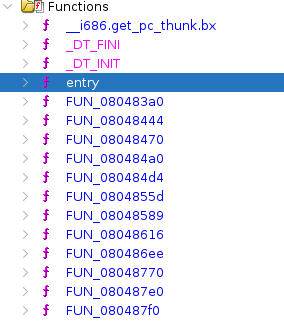

Мы уже знаем алгоритм работы:
1. Идем в `entry`.
2. Находим последний `PUSH` перед вызовом `__libc_start_main` (`PUSH FUN_080486ee`).
3. Переходим по адресу и восстанавливаем цепочку функций: `main` -> `check` -> `parell` -> `dummy` -> `che`.

Переименовываем функции и получаем чистый, структурированный проект:

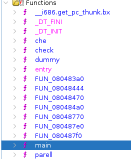

На уровне высокоуровневой логики код один в один повторяет задания 0x07 и 0x08. Но если мы заглянем в ассемблерный листинг `main`, то увидим кое что новое.

---

### Низкоуровневая магия: позиционно-независимый код (PIC)

Смотрим в листинг функции `main`:

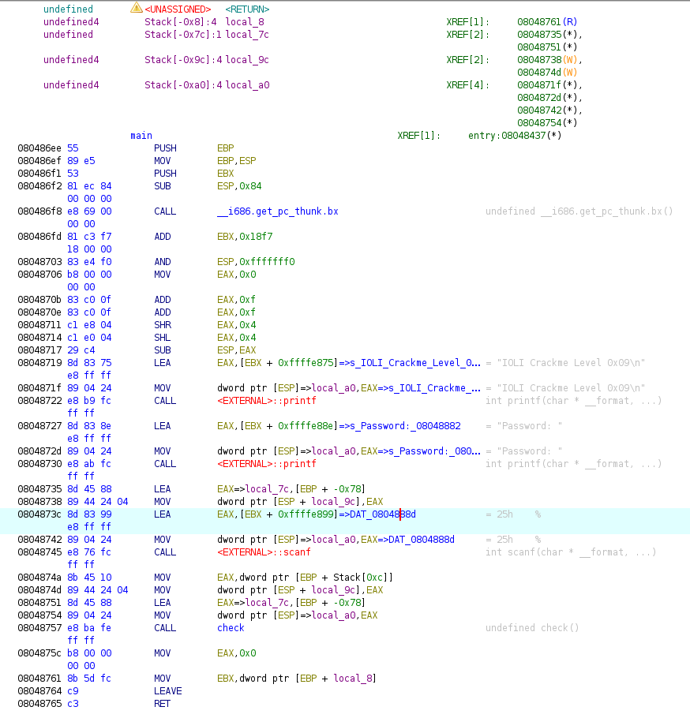

Сразу бросаются в глаза непривычные инструкции в прологе:

```asm
080486ee  55              PUSH  EBP
080486ef  89 e5           MOV   EBP, ESP
080486f1  53              PUSH  EBX
080486f2  81 ec 84...     SUB   ESP, 0x84
080486f8  e8 69 00 00 00  CALL  __i686.get_pc_thunk.bx
080486fd  81 c3 f7 18 00 00  ADD   EBX, 0x18f7
```

И дальше все вызовы строк выглядят не так, как раньше:
```asm
08048719  8d 83 75 e8 ff ff  LEA   EAX, [EBX + -0x178b] ; "IOLI Crackme Level 0x09\n"
...
08048727  8d 83 8e e8 ff ff  LEA   EAX, [EBX + -0x1772] ; "Password: "
...
0804873c  8d 83 99 e8 ff ff  LEA   EAX, [EBX + -0x1767] ; DAT_0804888d ("%s")
```

Раньше программа загружала строки по прямым абсолютным адресам:
`MOV [ESP], 0x08048568`. 
Здесь же адреса вычисляются динамически через регистр `EBX`!

### Зачем нужен `__i686.get_pc_thunk.bx`?

В 64-битных системах (x86-64) процессор умеет адресовать данные относительно текущего указателя инструкций: `[RIP + offset]`. Это позволяет коду выполняться по любому адресу в памяти.

Но в 32-битной архитектуре x86 **нет прямой адресации относительно EIP**! Процессор x86 не позволяет команде `MOV` или `LEA` прочитать значение регистра `EIP`.

Как же скомпилировать код так, чтобы он мог обращаться к глобальным переменным и таблице GOT (Global Offset Table), не привязываясь к жестким абсолютным адресам?

Компиляторы GCC придумали изящный трюк с функцией-переходником (thunk):

1. Команда `CALL __i686.get_pc_thunk.bx` совершает вызов подпрограммы. При этом процессор автоматически кладёт на вершину стека адрес следующей инструкции (`080486fd` — адрес возврата).
2. Заглянем внутрь этой функции:
   ```asm
   mov ebx, [esp]
   ret
   ```
   Она просто читает адрес возврата с вершины стека прямо в регистр `EBX` и возвращается!
3. Теперь в регистре `EBX` лежит точный адрес текущей инструкции в памяти (`080486fd`).
4. Следующая инструкция `ADD EBX, 0x18f7` прибавляет смещение к таблице глобальных данных.
5. Теперь `EBX` служит базовым указателем для всей секции данных, и любые строки загружаются через смещение: `[EBX - 0x1767]`.

В старых декомпиляторах (вроде radare2/r2dec тех лет) такие конструкции часто ставили инструмент в тупик: строки отображались как непонятные указатели `DAT_0804888d`. Но современная Ghidra автоматически эмулирует вычисление базы `EBX`, переходит по адресу и услужливо подсказывает нам, что там лежит строка `"%s"`.

---

## Проверка всех трех решений

Условия для 0x07, 0x08 и 0x09 полностью одинаковы:
1. Задаем переменную окружения с префиксом `LOL`:
   ```bash
   export LOL=1
   ```
2. Запускаем бинарники и вводим наш четный пароль с суммой цифр 16:

```bash
$ export LOL=1

$ ./crackme0x07
IOLI Crackme Level 0x07
Password: 88
Password OK!

$ ./crackme0x08
IOLI Crackme Level 0x08
Password: 88
Password OK!

$ ./crackme0x09
IOLI Crackme Level 0x09
Password: 88
Password OK!
```

Все задачи успешно пройдены!

---

## Финал серии IOLI Crackme

Вот мы и закончили разбор всех десяти заданий серии IOLI Crackme (от 0x00 до 0x09).

Теперь у нас есть прочный фундамент статического анализа исполняемых файлов в Ghidra. Впереди — разбор реальных крякмисов, малвари и более комплексных реверс-задач!
